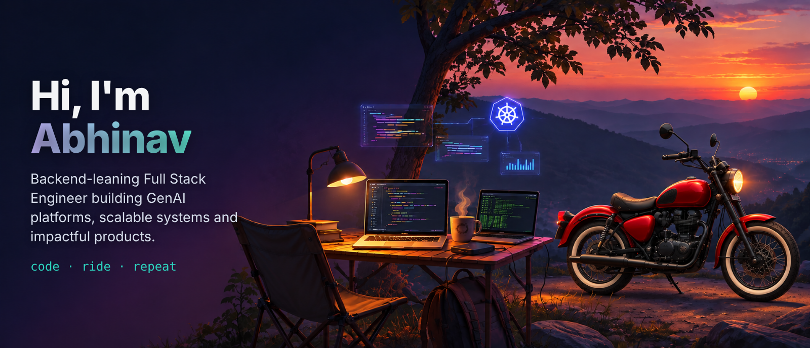

  

## Featured project

| Project | What it is | Stack |
|---|---|---|
| [**Sakha**](https://github.com/Abhinav-3359/chatBot) · [Live demo](https://chat-bot-chi-six.vercel.app/) | Users create chatbots grounded in their own documents, with a real-time voice mode that supports barge-in. | Java 21, Spring Boot, React, FastAPI, Pinecone, Groq |
