  

  
  
  

## About me

Senior Software Engineer at **InfoEdge (Naukri)**, building a GenAI platform used across product teams. I work on LLM streaming, model routing and fault-tolerant async inference with **Java, Spring Boot and Kafka**, and I build full-stack projects on the side.

## Currently working on

- GenAI platform engineering at InfoEdge: streaming, smart model routing, async batch inference
- **Sakha**: a multi-tenant RAG chatbot platform with real-time voice (Spring Boot, Pinecone, Groq, Whisper)

## Featured project

| Project | What it is | Stack |
|---|---|---|
| [**Sakha**](https://github.com/Abhinav-3359/chatBot) · [Live demo](https://chat-bot-chi-six.vercel.app/) | Users create chatbots grounded in their own documents, with a real-time voice mode that supports barge-in. | Java 21, Spring Boot, React, FastAPI, Pinecone, Groq |

## Tech I work with

**Languages:** Java · Python · JavaScript · C++
**Backend:** Spring Boot · REST APIs · Kafka · MySQL · Aerospike · MongoDB
**AI / LLM:** Vertex AI (Gemini) · Azure OpenAI · OpenAI · Anthropic · tool calling · RAG
**Frontend:** React · Next.js
**DevOps:** Docker · Kubernetes · GitLab CI · Jenkins

## Get in touch

Always up for a conversation about GenAI systems, backend engineering or competitive programming. Reach me through my [portfolio](https://itzmeabhinav.com).
